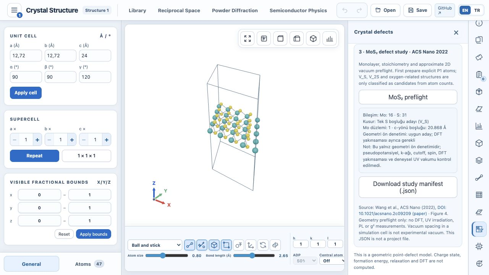

# D5.1 başlangıç adayının gerçek editör testi

Üretilmiş `qe-mos2-d5-preparation-20261029/V_S/initial.cif` gerçek
KristalYapı sayfasının Dosya aç akışından içe aktarıldı. Uygulama 47 açık
P1 atomu, a=b=12.72 Å, c=24 Å, γ=120° ve 1×1×1 gösterim tekrarını kaydetti.
Mevcut MoS₂ geometri ön denetimi Mo:16/S:31, tek S boşluğu adayı,
bir Mo düzlemi ve c yönünde 20.868 Å atomsuz aralık buldu.

Bu yalnız hazırlık/CIF/UI kontrolüdür; kusurlu yapı için DFT, relaksasyon,
spin veya kararlılık sonucu değildir. Aday henüz hesaplanmadı.

DFT formunda ayrıca `.qe-workflow` grid stilinin `hidden` niteliğini
geçersiz kıldığı gözlendi ve D4'te düzeltildi. SCF seçiliyken elektronik
ayarlar `hidden=true/display=none`, elektronik iş akışı seçiliyken
`hidden=false/display=grid` olarak gerçek tarayıcıda doğrulandı. İş gönderilmedi.
