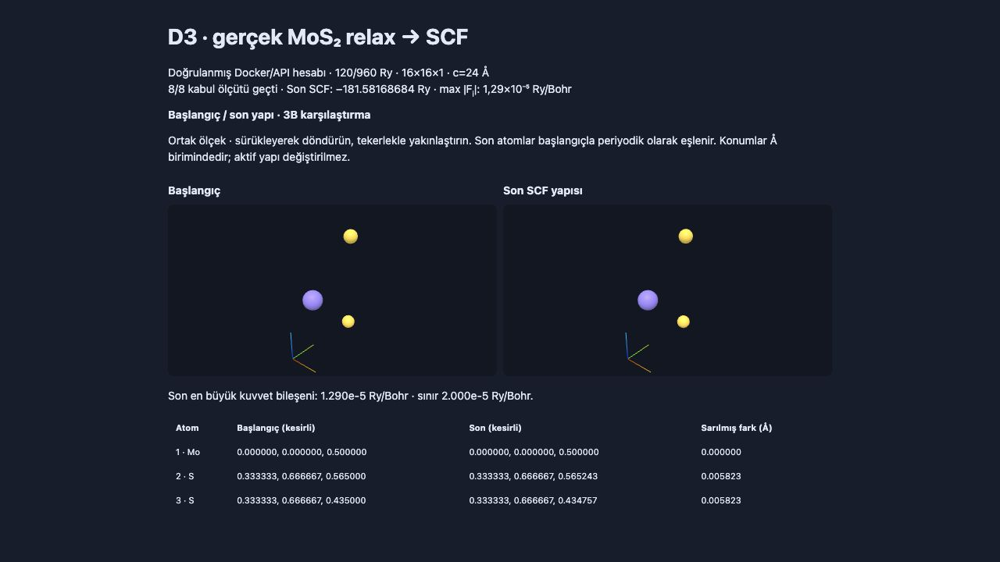

# D3 gerçek MoS₂ kabulü — sekiz ölçüt geçti

[Linux/Docker kabul çalışması](https://github.com/alorak/kristalyapi/actions/runs/40793759416),
ön kayıtlı kaynak `2b3c6dce97568f0fca9b85a3e35acedde2399a0a`, 55 dk 55 sn.
D2.2c'nin doğrulanmış ideal PBE/spinsiz 1H-MoS₂ referansından sabit hücreli
BFGS `relax → bağımsız scf`, ardından aynı son geometride ayrı 140 Ry SCF.
120/960 Ry, 16×16×1, c=24 Å; yüksek kesme kontrolü 140/1120 Ry.

| Aşama | Enerji (Ry) | Son SCF hata tahmini (Ry) | En büyük kuvvet bileşeni (Ry/Bohr) |
| --- | --- | --- | --- |
| BFGS sonu | -181.5816868428 | 3.2e-11 | 1.484e-5 |
| Bağımsız 120 Ry SCF | -181.58168684 | 1.2e-9 | 1.290e-5 |
| Ayrı 140 Ry SCF | -181.58174581 | 5.6e-9 | 5.500e-7 |

Üç aşamanın kuvvet bileşenleri ≤1e-4 Ry/Bohr; 120/140 kuvvet bileşeni
farkı 1.345e-5 ≤1e-4 Ry/Bohr. Rahatlamış geometride kesme enerjisi farkı
**0.267442574 ≤1 meV/atom**. BFGS sonu/bağımsız SCF farkı
2.8e-9 ≤1e-6 Ry. En büyük atom yer değiştirmesi 0.0058226472 ≤0.5 Å;
enerji başlangıca göre 4.691e-5 Ry azaldı. Sekiz ön kayıtlı ölçüt 8/8 geçti.
İç BFGS/120 Ry son SCF kuvvet hedefi daha sıkı 2e-5 Ry/Bohr olarak
hesaptan önce kaydedilmişti; fiziksel kabul sınırı 1e-4 olarak korundu.

Ham `JOB DONE.`, BFGS yakınsaması, son iyonik enerji değişimi, 26 nötr
elektron, API/raw enerji ve atomik kuvvetler, atom türü/sırası, sabit hücre,
başlangıç/son konumları, girdi/çıktı/stderr ve staged Mo/S UPF SHA-256
kontrol edildi. 15 kaynak hash'i çalışma commit'indeki dosyalardan yeniden
hesaplandı ve eşleşti. Gerçek worker 6 GiB RAM, swap kapalı; kaynaklar kaldırıldı.



21 özgün artifact dosyası değiştirilmeden korunur. `inspection.json`,
`github-actions.json`, `comparison.png` ve bu belge sonraki inceleme ekleridir.
İlk Si parser hatası ve başarılı Si işleyiş denemesi ayrı klasörlerde korunur.
Bu kabul sabit hücreli kusursuz MoS₂ geometri/kuvvet ve sonlu kesme kontrolüdür;
hücre optimizasyonu, bant/DOS yakınsaması, SOC ve optik doğruluk ayrı kapsamlardır.

```bash
python3 tools/qe_relax_acceptance.py --verify validation-results/qe-mos2-d3-20261029-amd64
```
