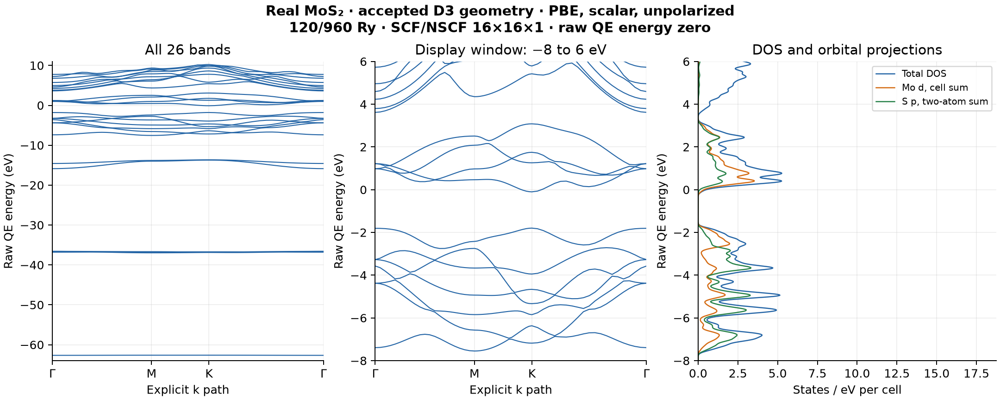
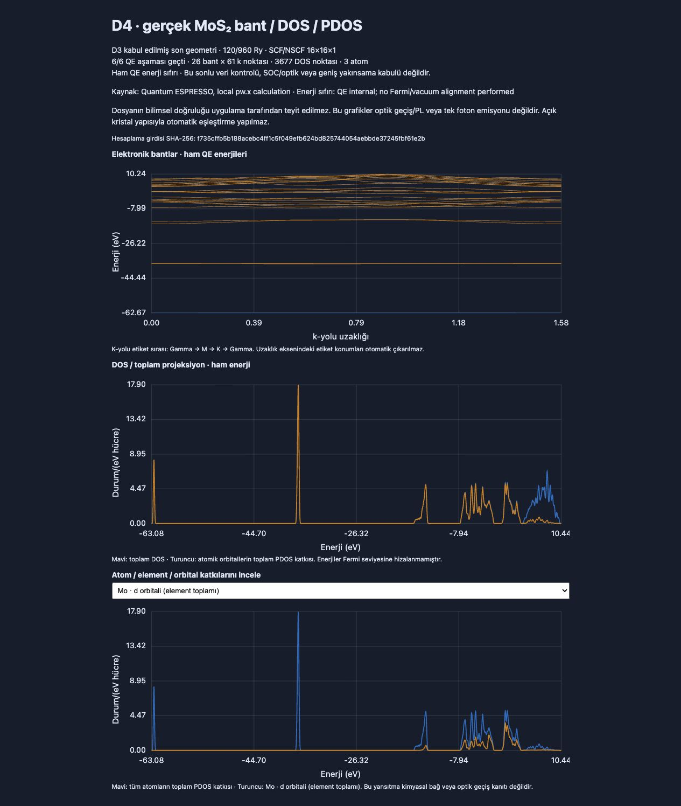

# D4 gerçek MoS₂ bant / DOS / PDOS kabulü — geçti

[Linux/Docker çalışması](https://github.com/alorak/kristalyapi/actions/runs/40821361993),
ön kayıtlı kaynak `d25e112312acd6f02591c0abe5b03acc5ed3b024`, 35 dk 38 sn.
D3'ün kabul edilmiş son geometrisi, aynı doğrulanmış Mo/S UPF'leri,
120/960 Ry, SCF ve NSCF 16×16×1; 26 bant ve açık Γ→M→K→Γ yolu.

- **6/6 gerçek aşama:** SCF, bands, bands.x, NSCF, dos.x, projwfc.x.
  Bütün ham `JOB DONE.`, aşama/girdi/çıktı/UPF/PDOS hash'leri ve API eğrileri eşleşti.
- **26×61 bant**, **3677 DOS noktası**, üç atomun s/p ve Mo'nun d projeksiyonları.
- Kaynak SCF **-181.58168684 Ry**, son hata tahmini **1.2e-9 Ry**,
  kuvvet bileşeni **1.29e-5 Ry/Bohr**; D3 son enerjisi ve girdisi tam tekrarlandı.
- Tam DOS integralinin 52 duruma uzaklığı **6.573999997e-6 ≤0.2**.
  Kaynak enerji farkı 0≤1e-6 Ry; kuvvet 1.29e-5≤1e-4 Ry/Bohr.
- Raw PDOS dosyası 3678 nokta; DOS aralığındaki **3677 mevcut nokta**
  birebir seçildi, dış uçtaki tek nokta dışarıda kaldı. İnterpolasyon,
  enerji kaydırması veya yeniden ölçekleme yapılmadı.
- Atomik projeksiyonların toplamındaki en büyük basılı fark 0.067269
  durum/eV; ayrıştırıcının önceden tanımlı basım toleransları geçti.
- PW aşamalarında 26 nötr elektron; 19 kaynak SHA-256 değeri kayıtlı
  commit'teki dosyalardan yeniden hesaplandı ve eşleşti.
- Gerçek worker 6 GiB RAM, swap kapalı; kaynaklar temiz kaldırıldı.



[SVG](electronic-structure.svg): orta/sağ panel yalnız gösterim penceresidir;
ham enerji sıfırı değiştirilmedi. Bütün bantlar solda bulunur. Fermi/vakum
hizalaması veya deneysel bant aralığı iddiası yapılmaz.



[İkinci S atomunun p seçimi](spectra-s2-p.png) tarayıcıda ayrıca doğrulandı.
Bu görseller uygulamanın kendi ayrıştırıcı ve çizim bileşeninden üretildi.

46 özgün artifact dosyası değiştirilmeden korunur. `inspection.json`,
`github-actions.json`, görseller ve bu belge sonraki bağımsız inceleme ekleridir.
D4 sonucundan sonra gelen UPF/bant kapasitesi ve form görünürlük düzeltmeleri
bu hesabın kaynak commit'ini değiştirmez; ayrı test ve Docker ön kontrolü vardır.

**Kapsam:** Bu sabit yol/örgüde gerçek API/solver zinciri ve veri tutarlılığı
kabulüdür. Bant sayısı, k-örgüsü ve DOS genişliği yakınsaması, spin/SOC,
optik veya tek-foton doğruluğu ayrı kabul gerektirir. D5 kusur hesapları
bu üç atomlu kusursuz yapıdan farklı kaynak ve fiziksel kontroller ister.

```bash
python3 tools/qe_electronic_acceptance.py --verify validation-results/qe-mos2-d4-20261029-amd64
```
